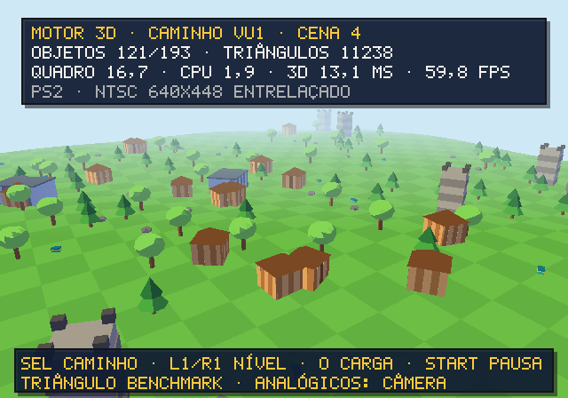

# Brisa — PlayStation 2 Edition

Battle Royale 3D cartunesco com construção, para **uma pessoa contra bots**, no
**PlayStation 2 original** (C/C++, PS2SDK, gsKit). É uma edição independente da
família **Ventania** ([pdrinme/ventania](https://github.com/pdrinme/ventania)):
tem a mesma personalidade, a mesma direção de arte e os mesmos sistemas, mas
código, motor, pipeline, build e documentação são próprios.

> Não é o Ventania portado. Nada do projeto Godot roda no PS2. O Ventania é
> consultado como referência (somente leitura), e seus assets originais são
> convertidos por um pipeline próprio.

## Status

**Etapa 2 (motor gráfico): pronta e testada no emulador; falta o benchmark no
console.** Há dois caminhos de renderização 3D: o do EE e o do VU1 (com
microprograma próprio). Os dois usam a luz toon de 2 faixas do Ventania,
Z-buffer e neblina. A cena de teste vem com benchmark automático (▲). O teste
da Etapa 1 no console também continua pendente. Veja
[docs/TESTE_NO_CONSOLE.md](docs/TESTE_NO_CONSOLE.md) e
[BRISA_ROADMAP.md](BRISA_ROADMAP.md).



## Compilar e testar

```bash
source tools/ambiente/env.sh
```

```bash
make
```

```bash
make testes
```

```bash
make previa
```

```bash
make emulador
```

| Alvo | Resultado |
|---|---|
| `make` | `build/ps2/brisa.elf` (o que vai para o console) |
| `make testes` | Testes do núcleo no PC (`TESTES_OK`) |
| `make previa` | Cena renderizada no PC (referência) em `build/previa/*.png` |
| `make emulador` | O ELF no Play! (sem BIOS) com vídeo: a cena pelo VU1 e pelo EE, e o controle simulado; quadros em `build/emulador/` (`EMULADOR_OK`) |
| `make emulador-completo` | O ELF no AutoTest do Play! até o fim (roteiro + benchmark reduzido) |

As ferramentas de emulador são instaladas por `tools/ambiente/instalar_emulador.sh`.

## Documentos

| Documento | Conteúdo |
|---|---|
| [docs/estudo/SISTEMAS_VENTANIA.md](docs/estudo/SISTEMAS_VENTANIA.md) | O Ventania sistema por sistema: como funciona, regras, visual, adaptação ao PS2, o que simplificar e o que refazer, com o estado real do código |
| [BRISA_ARCHITECTURE.md](BRISA_ARCHITECTURE.md) | Hardware, módulos, renderização, memória, formatos, save, patches, testes, decisões |
| [BRISA_GAME_DESIGN.md](BRISA_GAME_DESIGN.md) | Regras do Brisa, valores iniciais (do Ventania) e o que muda |
| [BRISA_ROADMAP.md](BRISA_ROADMAP.md) | Etapas 0–13, aceites e riscos |
| [ASSET_LICENSES.md](ASSET_LICENSES.md) | Política, reaproveitamento arquivo a arquivo, dependências |
| [docs/PIPELINE_ASSETS.md](docs/PIPELINE_ASSETS.md) | Conversão Ventania → Brisa (modelos, texturas, mapa, dados, áudio) |
| [docs/ESTILO_VISUAL_PS2.md](docs/ESTILO_VISUAL_PS2.md) | A identidade visual do Ventania traduzida para o PS2 |
| [docs/FERRAMENTAS_PS2DEV.md](docs/FERRAMENTAS_PS2DEV.md) | Toolchain validado, versões, emulador Play! e como testar |
| [docs/TESTE_NO_CONSOLE.md](docs/TESTE_NO_CONSOLE.md) | Roteiro do teste no PS2 real e o que reportar |
| [docs/SINCRONIA_VENTANIA.md](docs/SINCRONIA_VENTANIA.md) | Versão de referência do Ventania e o processo de sincronia |
| [docs/auditoria/](docs/auditoria/) | Saídas medidas: assets, reaproveitamento, layout da ilha, densidade por setor |

## Ferramentas de auditoria do Ventania

```bash
tools/ambiente/instalar_ps2dev.sh
```

```bash
tools/ambiente/verificar_toolchain.sh
```

```bash
python3 tools/auditoria/auditar_ventania.py --ventania ../ventania --json docs/auditoria/assets_ventania.json --md docs/auditoria/assets_ventania.md
```

```bash
python3 tools/auditoria/lista_reuso.py docs/auditoria/assets_ventania.json > docs/auditoria/REUSO_GLB.md
```

```bash
GODOT=/caminho/godot-4.7.2 tools/auditoria/extrair_ilha.sh ../ventania docs/auditoria/ilha_ventania_layout.json
```

```bash
python3 tools/auditoria/densidade_mapa.py --layout docs/auditoria/ilha_ventania_layout.json --assets docs/auditoria/assets_ventania.json --setor 64
```

## Estrutura (a de agora e a planejada para a Etapa 1)

```
brisa-ps2/
├── src/
│   ├── nucleo/              ✅ tipos, arena, passo fixo, controle, estatísticas, lista 2D, fonte, formato, mat (3D)
│   ├── render3d/            ✅ malhas, cena, luz toon, pipeline de referência (caminho EE)
│   ├── jogo/                ✅ telas (tela_boot da Etapa 1, cena_teste da Etapa 2)
│   ├── plataforma/ps2/      ✅ IOP/IRX, gsKit, libpad, relógio, caminho EE (GIF), caminho VU1 (VIF1 + vu1/toon.vsm)
│   ├── plataforma/host/     ✅ PC: rasterizador de software, PNG, controle por roteiro
│   ├── main.cpp             ✅
│   └── (planejado) conteudo/ mundo/ personagem/ armas/ inventario/ construcao/ bots/ partida/ ui/ audio/ progressao/ save/
├── data/                    JSON de conteúdo (armas, itens, cosméticos, temporadas, loja)
├── assets/                  catálogo do Brisa e saídas convertidas
├── tools/
│   ├── ambiente/            ✅ instalar e verificar o toolchain (+ sonda)
│   ├── auditoria/           ✅ leitor GLB, auditoria, extrator da ilha, densidade, reuso
│   ├── emulador/            ✅ capturador no Play!, verificação da saída, PPM→PNG
│   ├── conversor_modelos/  conversor_texturas/  conversor_mapa/  compilador_dados/  empacotador/   (Etapa 3+)
├── tests/                   ✅ testes do núcleo no PC
├── docs/
├── Makefile                 ✅
└── BRISA_*.md, ASSET_LICENSES.md, CHANGELOG.md
```
